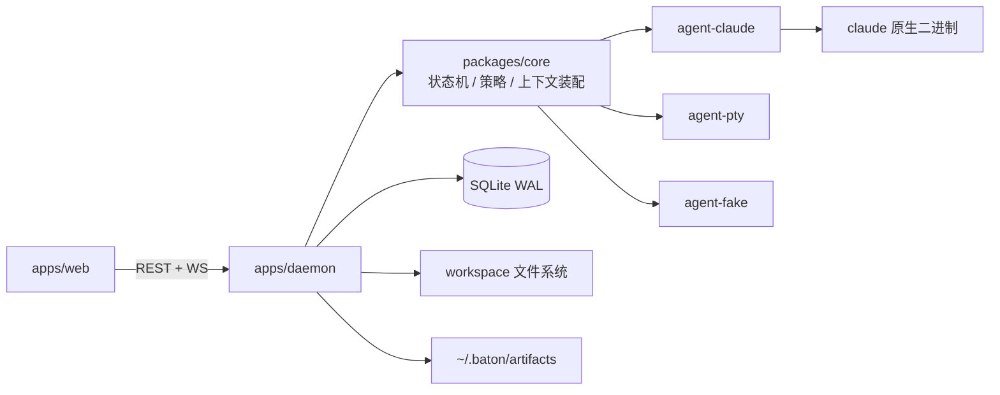

# baton v1 架构设计与工程规范

> baton 不演奏，只定拍子。
>
> 一个本地优先的 Agent 调度驾驶舱：画布是共享内存，看板是状态投影，总管只负责派活与验收。

## 0. 文档信息

- **状态**：设计已确认，本文档为锁定版本。实现阶段如需变更，走新的 spec 或 ADR，并回链本文。
- **读者**：参与 baton 的 2-3 名研发，以及参与实现的 Agent。
- **范围**：项目架构、技术方案、项目管理、开发约束、打包与 CI、Docker 部署。
- **非目标（v1 明确不做）**：DSH 插件形态、飞书/GitHub 外部触发器、向量语义召回、可交互真终端、多用户与权限体系、DAG 自动编排。
- **背景材料**：`baton.ai/复刻CanvasAgents工作台.md`（讨论稿，不进仓库）。本 spec 是对该草案的事实校正与范围收敛。

### 0.1 与草案的四处事实校正

1. **DSH 没有 Python SDK**。本机 DSH 安装目录是 Cordis/Node 插件体系；npm 上只有 `@deepseek-ai/dsh`（CLI，`engines.node >= 24.9`）与 `@deepseek-ai/dsh-headless`（one-shot runner，无 Host/HTTP/浏览器层），不存在 `dsh-sdk`。
2. **Claude Code 不需要 PTY 也能拿到结构化流**。官方 `@anthropic-ai/claude-agent-sdk` 提供流式事件与 `canUseTool` 授权回调；PTY 只作为无结构化接口时的兜底。
3. **没有可 fork 的整机项目**。最接近的 `vibe-kanban` 已进入停服期且是 Rust；DSH 生态的画布插件只能跑在 DSH 内。因此复用落在组件层。
4. **公开仓库默认无许可即"保留所有权利"**。本 spec 同步落地 MIT LICENSE。

---

## 1. 产品定义

### 1.1 定位

baton 把"人肉盯终端"变成"看板 + 验收"：你框选画布上的上下文交给 Agent，Agent 在隔离工作区执行，完成后带着可执行证据（verify 结果 + diff）回到验收卡，你只做通过或打回。

### 1.2 五条不变量

1. **一个节点 = 一个独立会话**。上下文通过画布连线显式传递，不靠把所有历史塞给同一个 Agent。
2. **画布是共享内存，不是装饰**。框选与连线是强制注入；向量召回只在预算有剩余时作为补充，永不作为唯一依据。
3. **状态机是唯一事实来源**。看板、画布节点、通知都是状态机的投影，不允许各自维护一套状态。
4. **验收必须带可执行证据**。没有 verify 退出码、输出摘要与 diff 统计的交付，不算完成。
5. **危险操作默认拒绝**。自动批准必须命中白名单、可审计、可一键停止。

### 1.3 v1 边界

**做**：画布（文本/图片/文件/Agent/验收节点）、框选与连线注入、任务看板、总管对话、单引擎执行（Claude Code）、verify 验收、自动重试与白名单自动批准、定时汇报、桌面端 + 移动端只读、npm 与 Docker 分发。

**不做**：DSH 插件、外部触发器、向量库、真终端、多用户、远端多机调度、DAG 自动编排。

---

## 2. 架构

### 2.1 仓库结构

```
baton/
├── apps/
│   ├── daemon/          # Node + TS：HTTP/WS、调度、适配器、SQLite
│   └── web/             # Vite + React SPA：画布 / 看板 / 总管
├── packages/
│   ├── protocol/        # zod schema + AG-UI 事件类型 + 领域事件（三端唯一真源）
│   ├── core/            # 纯领域逻辑：状态机、上下文装配、策略、验收（无 IO）
│   ├── adapters/        # agent-claude / agent-pty / agent-fake
│   └── ui/              # 共享 React 组件，供 web 与 M2 的 DSH 插件复用
├── docs/{specs,adr,runbooks}
├── .github/workflows/
├── compose.yaml
├── Dockerfile
└── pnpm-workspace.yaml
```

依赖方向：`apps/*` → `packages/core` / `packages/protocol` / `packages/adapters`；`packages/core` 只依赖 `protocol`，不依赖 Node IO；`packages/ui` 只依赖 `protocol` 与 React。方向由 dependency-cruiser 在 CI 强制。

### 2.2 进程与端口

单 daemon、单端口（默认 `7317`）：

- `/api/*`：REST，负责 CRUD、上传、健康检查、配对登录。
- `/ws`：唯一实时通道，承载命令、事件、审批与状态推送。
- `/`：托管 `apps/web` 的构建产物。
- 执行器为子进程：`claude` 原生二进制（由 SDK 的平台包提供），通过适配器隔离。
- 存储：SQLite（WAL），默认 `~/.baton/baton.db`；容器内 `/data/baton.db`。



### 2.3 任务生命周期

1. 用户在画布上框选节点、拉线到 Agent 节点，点击启动；或总管通过工具派活。
2. daemon 装配上下文（见 2.7），创建 `task` 与 `session`。
3. 适配器启动执行器：默认在项目目录；开启 worktree 时先建独立分支与工作树。
4. 适配器把引擎输出归一化为 AG-UI 事件，写入 `event` 表并广播到 WS。
5. 遇到授权请求：状态转 `waiting_input`，画布节点高亮，总管同步提示；用户决定后回传引擎。
6. 执行结束：状态转 `verifying`，在任务工作区跑 verify，结果写 `review`。
7. 进入 `review`：验收卡展示退出码、输出尾部、diff 统计；用户通过或打回。
8. 打回则追加反馈并重新入队；通过则归档，按配置合并或丢弃 worktree。

### 2.4 领域模型

| 表 | 关键字段 | 说明 |
|---|---|---|
| `workspace` | `id, name, rel_path, created_at` | `rel_path` 相对 `BATON_WORKSPACES_ROOT`，保证本地与容器可迁移 |
| `canvas` | `id, workspace_id, viewport_json` | 每个 workspace 一张画布 |
| `node` | `id, canvas_id, type, x, y, w, h, group_id, data_json` | 多态节点：`text/image/file/agent/review/group` |
| `edge` | `id, canvas_id, source_id, target_id, type` | v1 只有 `context`；字段预留以后加执行流 |
| `task` | `id, workspace_id, node_id, title, prompt, status, engine, workspace_mode, branch, worktree_path, verify_command, retry_count` | 一次派活 |
| `session` | `id, task_id, adapter, engine_session_id, status, started_at, ended_at` | 一次引擎进程 |
| `event` | `id, session_id, seq, type, payload_json, ts` | 追加写，`UNIQUE(session_id, seq)`，用于断线重放 |
| `approval` | `id, session_id, request_json, decision, decided_by, decided_at` | 人工与自动批准都落库 |
| `review` | `id, task_id, verdict, verify_exit_code, verify_output, diff_stat_json, decided_at` | 验收证据 |
| `audit` | `id, ts, actor, action, detail_json` | 自动批准、策略变更、kill switch 的操作审计 |
| `notice` | `id, ts, kind, payload_json, read_at` | 定时汇报与站内通知 |

索引：`task(status)`、`event(session_id, seq)`、`node(canvas_id)`、`audit(ts)`。

### 2.5 状态机

状态：`todo → queued → running ⇄ waiting_input → verifying → review → done`，旁路 `failed / cancelled`。

| 从 | 事件 | 守卫 | 到 |
|---|---|---|---|
| `todo` | `enqueue` | 手动启动或总管派活 | `queued` |
| `queued` | `start` | 并发数未超上限 | `running` |
| `running` | `approval_requested` | 引擎请求授权 | `waiting_input` |
| `waiting_input` | `approval_allow` | — | `running` |
| `waiting_input` | `approval_deny` | — | `running`（拒绝理由回传引擎） |
| `waiting_input` | `cancel` | — | `cancelled` |
| `running` | `completed` | — | `verifying` |
| `verifying` | `verify_ok` | 退出码 0 | `review` |
| `verifying` | `verify_fail` | `retry_count < retryMax` 且自动驾驶开启 | `queued`（计数 +1，输出追加进提示） |
| `verifying` | `verify_fail` | 否则 | `review`（标记失败） |
| `review` | `approve` | — | `done` |
| `review` | `reject` | — | `queued`（反馈追加进提示） |
| 任意 | `cancel` | — | `cancelled` |
| `running` | `error` | 适配器致命错误 | `failed` |

约束：状态变更只能由 `packages/core` 的转移函数产生；daemon 与前端不得直接写 `status`。

### 2.6 适配器接口

```ts
export interface AgentAdapter {
  readonly name: 'claude-sdk' | 'pty' | 'fake'
  start(input: StartInput): Promise<AgentRun>
}

export interface StartInput {
  prompt: string            // 已装配好的上下文 + 任务
  cwd: string               // workspace 或 worktree
  systemPrompt?: string
  resumeSessionId?: string
  permissionMode: 'manual' | 'acceptEdits' | 'plan'
  policy: PolicySnapshot    // 只读快照，执行期不可变
}

export interface AgentRun {
  events: AsyncIterable<AgentEvent>          // 归一化为 AG-UI + CUSTOM
  approve(requestId: string, decision: 'allow' | 'deny', note?: string): Promise<void>
  send(text: string): Promise<void>          // 追加指令（打回重做）
  interrupt(): Promise<void>
  dispose(): Promise<void>
}
```

实现：

- `agent-claude`：基于 `@anthropic-ai/claude-agent-sdk`，用 `canUseTool` 承接授权，用 `resume` 承接打回；子代理事件映射为 AG-UI `SUBAGENT_*`。
- `agent-pty`：兜底，解析终端输出为纯文本事件；v1 只用于实验，不承诺授权闭环。
- `agent-fake`：脚本化事件流，供集成测试与 e2e 使用，保证调度层可确定性测试。

### 2.7 上下文装配

输入：选中的节点 id、画布边、目标 Agent 节点。

1. 显式集：选中节点，按 `(y, x, id)` 排序，保证确定性。
2. 上游集：沿 `context` 边反向做传递闭包，深度 ≤ 2，节点数 ≤ 40。
3. 排除目标 Agent 节点自身，去重。
4. 渲染：文本/Markdown 取正文；图片给路径与可选描述；二进制只给路径。每段包成 `<node id type title>`。
5. 预算：默认 12k token（按字符数估算），超预算时先丢最深的上游节点，末尾追加 `<truncated nodes="..."/>`。
6. 脱敏：默认排除 `.env*`、私钥、`*secret*`，命中策略 deny 的文件直接跳过并在结果中标注。
7. 输出为确定性字符串，纳入快照测试。

```xml
<task>把登录页改成暗黑模式</task>
<context>
  <node id="n_1" type="text" title="PRD">...</node>
  <node id="n_2" type="image" title="设计稿" src="artifacts/n_2.png"/>
</context>
<constraints>只改 src/pages/login；不要动路由配置。</constraints>
```

### 2.8 策略引擎

项目内 `.baton/policy.json`，workspace 可在 DB 覆盖；快照传入适配器，执行期不可变。

```json
{
  "verify": { "command": "pnpm verify", "timeoutSec": 900, "maxOutputBytes": 262144 },
  "approval": {
    "default": "ask",
    "allow": [
      "Read", "Grep", "Glob",
      "Edit:src/**", "Edit:tests/**",
      "Bash:pnpm (test|lint|typecheck|build|install --frozen-lockfile)"
    ],
    "deny": [
      "Bash:sudo *", "Bash:rm -rf *", "Bash:curl * | sh", "Bash:git push *",
      "Edit:**/.env*", "Edit:.git/**"
    ],
    "autoApproveMaxRisk": "low"
  },
  "autopilot": { "enabled": false, "retryMax": 2, "digestCron": "0 9,21 * * *" }
}
```

求值顺序：**deny > allow > ask**。风险分级：`low`（只读与测试）、`medium`（写工作区文件）、`high`（网络、git 写操作、删除）。

自动批准条件（全部满足）：命中 `allow`、风险 ≤ `autoApproveMaxRisk`、`autopilot.enabled` 为真、kill switch 未触发。每次自动批准写入 `audit`，并在对应 Agent 节点上留下可见标记。

### 2.9 验收执行

verify 命令解析优先级：任务级配置 > 项目 `.baton/policy.json` > `package.json` 的 `verify` script > `pnpm test` > 失败并提示配置。

执行：在任务工作区以 shell 运行；超时强杀进程组；捕获 stdout+stderr，保留头尾各 128KB；环境变量剔除 `BATON_TOKEN` 等敏感项；记录退出码、耗时、`git diff --stat`。

验收卡内容：退出码与耗时、输出尾部、改动文件与增删行、失败时的首条错误、操作按钮（通过 / 打回 / 查看完整日志）。

### 2.10 通信协议

信封：`{ v: 1, id?: string, type: string, ts: number, seq?: number, payload: unknown }`。

- 客户端命令：`auth`、`resume`、`task.create/cancel/retry`、`review.decide`、`approval.decide`、`node.create/update/delete`、`edge.create/delete`、`context.inject`、`supervisor.send`。
- 服务端事件：`ack`、`error`、`task.status`、`session.event`、`approval.request`、`verify.result`、`canvas.patch`、`notice`。
- 断线重连：客户端带 `sinceSeq`，服务端从 `event` 表重放。
- 认证：浏览器打开 `/?token=`（或 `/auth?token=`）换取 `httpOnly + SameSite=Strict` cookie，随后跳转到无参数地址；非浏览器用 `Authorization: Bearer`。WS 建立后 5 秒内未认证则关闭。
- **不自造 Agent 事件模型**：会话流直接采用 AG-UI，自有语义走 `CUSTOM`。

| 适配器事件 | AG-UI 类型 |
|---|---|
| 运行开始 / 结束 / 错误 | `RUN_STARTED` / `RUN_FINISHED` / `RUN_ERROR` |
| 文本增量 | `TEXT_MESSAGE_CONTENT` |
| 推理增量 | `REASONING_MESSAGE_CONTENT` |
| 工具调用 | `TOOL_CALL_START` / `TOOL_CALL_ARGS` / `TOOL_CALL_END` / `TOOL_CALL_RESULT` |
| 子代理 | `SUBAGENT_STARTED` / `SUBAGENT_FINISHED` |
| 授权请求 | `CUSTOM{ name: "approval.request" }` |
| 任务状态 | `CUSTOM{ name: "task.status" }` |
| 验收结果 | `CUSTOM{ name: "verify.result" }` |

### 2.11 安全边界

- 默认只监听 `127.0.0.1`；`--host 0.0.0.0` 时 token 必填，缺失拒绝启动。
- token：32 字节随机十六进制，存 `~/.baton/token`；支持 `BATON_TOKEN` 与 `BATON_TOKEN_FILE`。
- 前端与 API 同源，**不引入 CORS**；开发环境用 Vite proxy。
- 路径 jail：所有文件操作经 `resolveWithin(root, p)`，并用 `realpath` 阻断软链逃逸。
- 命令执行只有两个入口：适配器内置命令、项目配置里的 verify 命令。**不向上层或模型暴露通用 shell**。
- 日志脱敏：键名匹配 `token|key|secret|authorization` 的值一律打码。
- Docker：非 root、只读根文件系统、`cap_drop: ALL`、不挂 docker.sock。

---

## 3. 技术选型与 OSS 复用

原则：**能直接用依赖的，不自研；能参考实现的，不复制代码。**

### 3.1 直接依赖

| 层 | 选型 | 许可 |
|---|---|---|
| 运行时 | Node 22（本地）/ Node 24（镜像）、TypeScript 5、pnpm 10 | MIT |
| 服务 | `fastify` 5 + `@fastify/websocket` + `@fastify/static` + `@fastify/cookie`、`pino`、`zod` 4 | MIT |
| 存储 | `better-sqlite3` 13 + `drizzle-orm` / `drizzle-kit` | MIT / Apache-2.0 |
| Agent | `@anthropic-ai/claude-agent-sdk`、`@ag-ui/core` | 非 OSI / MIT |
| 总管 | `ai` 7 + `@ai-sdk/deepseek` 或 `@ai-sdk/openai-compatible` | Apache-2.0 |
| 画布 | `@xyflow/react` 13 | MIT |
| 聊天 | `@assistant-ui/react` + 自定义 `ChatModelAdapter` | MIT |
| 渲染 | `streamdown`、`shiki`、`mermaid`、`react-markdown` | Apache-2.0 / MIT |
| 交互 | `react-resizable-panels`、`@dnd-kit/core` + `sortable`、`@tanstack/react-virtual`、`html-to-image`、`@uiw/react-codemirror` | MIT |
| Diff | `react-diff-view` + `diff` | MIT / BSD-3 |
| 状态 | `zustand`、`@tanstack/react-query` | MIT |
| UI | Tailwind 4、shadcn/ui、`lucide-react`、`sonner`、`cmdk` | MIT / ISC |
| 系统 | `execa`、`p-queue`、`simple-git`、`chokidar`、`croner`、`node-notifier`、`picomatch` | MIT |
| 工程 | `vitest`、`@playwright/test`、`tsup`、Vite、`changesets`、`dependency-cruiser`、ESLint 10、Prettier、husky、lint-staged、commitlint | MIT / Apache-2.0 |

### 3.2 借鉴实现，不复制代码

- `BloopAI/vibe-kanban`（Apache-2.0，已停服）：executor 抽象、worktree 隔离、diff review 流程。
- `answertsundere/dsh-canvas-plugin`（MIT）：会话三态判定、流式节点渲染、"绝不从静默推断空闲"。
- `ljcoder2015/dsh-canvas-flow`（MIT）：卡片产物目录组织与导出。

### 3.3 明确排除

| 方案 | 原因 |
|---|---|
| tldraw | 非 OSI 许可，商用受限 |
| vibe-kanban 作为依赖 | 项目停服，且为 Rust 技术栈 |
| n8n / dify / Flowise / ComfyUI | Sustainable Use / 附加条款 / GPL，许可不允许 |
| react-kanban / react-trello | 已停更（2023 / 2022） |
| Langflow | MIT，但为 Python + DAG 执行模型，与"画布即上下文"不符 |
| Monaco | v1 包体过大，CodeMirror 足够 |

### 3.4 自研清单

| 模块 | 内容 | 预估 |
|---|---|---|
| 上下文装配器 | 节点/边 → XML，预算、截断、确定性 | 300-500 行 |
| 状态机 + 策略引擎 | 转移函数、deny/allow/ask、审计、kill switch | 400-600 行 |
| 验收执行器 | verify、超时、输出裁剪、diff 统计、重试 | 约 300 行 |
| 画布组合层 | 节点类型注册、投喂交互、缩略图降级 | 约 500 行 |
| Claude → AG-UI 映射 | 适配器 | 约 300 行 |

合计约 2k 行核心逻辑，其余为依赖与配置。

### 3.5 许可合规

- 仓库采用 MIT，见 `LICENSE`。
- Apache-2.0 依赖保留声明，汇总在 `THIRD_PARTY_NOTICES.md`。
- Claude Agent SDK 为非 OSI 许可：只作为依赖，不 fork、不再分发其源码。

---

## 4. 项目管理

### 4.1 载体与标签

- 任务队列：GitHub Issues（仓库 `evanfang0054/baton`）。
- 标签：`area:daemon|web|core|adapter|ci|docs`、`type:feature|bug|spike`、`p:0|1|2`。
- 里程碑：M0-M3，对应第 7 节。GitHub Projects 看板可选，不作为强制流程。

### 4.2 Spec 与 ADR

- 非平凡改动先写 `docs/specs/YYYY-MM-DD-<topic>-design.md`，评审后再实现。
- 难以回退的决定写 `docs/adr/NNNN-<slug>.md`，至少包含：背景、选项、决定、后果。
- PR 描述必须链接对应 Issue；涉及契约变更时链接 spec 或 ADR。

### 4.3 分支与评审

- trunk-based：`main` 受保护，短分支 `feat/…`、`fix/…`，squash 合并，禁止 force push。
- 2-3 人规模：1 人 approve 即可，作者合并。
- 必需检查：`verify (22)`、`verify (24)`、`pack-check`、`e2e`、`build`。

### 4.4 DoD（Definition of Done）

1. 关联 Issue 与 spec/ADR；
2. 新增或更新测试，且 `pnpm verify` 通过；
3. 涉及 UI 的改动附截图或 gif；
4. 涉及协议或 schema 的改动附迁移说明与契约测试；
5. 更新相关文档（README 保持简短，细节进 `docs/`）。

### 4.5 发版

- `changesets` 管理 `@evanfang0054/baton` 的版本与 changelog；内部包（`protocol`、`core`、`adapters`、`ui`）只做 workspace 依赖，不单独发布，构建时打包进 CLI。
- 打 tag `vX.Y.Z` 触发发布：npm 包、GHCR 镜像、GitHub Release。
- 预发布用 `vX.Y.Z-rc.N`，不影响 `latest` 标签。

### 4.6 自举

M1 起用 baton 开发 baton：任务从 Issue 手动贴入，M2 再接 GitHub 触发。自举暴露的问题优先级高于新功能。

---

## 5. 开发约束

### 5.1 类型与契约

- `strict` + `noUncheckedIndexedAccess`；`exactOptionalPropertyTypes` 暂不开启（第三方类型成本过高）。
- 协议与配置只在 `packages/protocol` 用 zod 定义，类型由 `z.infer` 推导；禁止手写重复类型。
- 导出 API 禁止 `any`；确需逃逸时用 `unknown` + 解析函数。

### 5.2 分层与依赖方向

- `packages/core` 是纯函数层：不得 import `node:fs`、`node:net`、`apps/*`；IO 通过端口接口注入。
- `apps/web` 不得 import `apps/daemon` 或任何 Node 内置模块。
- 适配器只能通过 `AgentAdapter` 接口被调用；上层不得感知具体引擎。
- 由 dependency-cruiser 规则在 CI 强制，违规即失败。

### 5.3 错误与日志

- 统一 `AppError { code, message, details? }`；WS 错误必须带 `code`。
- 禁止抛出裸字符串；适配器异常必须转为 `RUN_ERROR` 事件并落库。
- 日志用 pino 结构化输出；敏感字段按 2.11 脱敏。

### 5.4 安全红线

- 不实现通用 shell 接口；不执行模型生成命令。
- 所有路径经 jail 校验；拒绝 `..`、绝对路径逃逸与软链逃逸。
- 新增外部输入（HTTP/WS/文件）必须过 zod 校验。
- 自动批准逻辑变更必须同时更新审计与测试。

### 5.5 数据迁移

- 每次 schema 变更附带 drizzle migration，并在 fixture DB 上跑通升级与回滚。
- 迁移脚本禁止依赖应用代码；只使用 SQL 与 drizzle schema。

### 5.6 提交与钩子

- Conventional Commits + commitlint。
- husky：pre-commit 跑 lint-staged；pre-push 跑 typecheck + unit。
- 禁止提交 `TODO` 占位实现；未完成的能力用 feature flag 包裹并写清默认值。

### 5.7 测试要求

- `core` 的转移函数、上下文装配、策略求值必须有单元测试与快照测试。
- daemon 的 WS 协议用 `agent-fake` 做集成测试。
- 关键路径（建任务 → 授权 → verify → 验收）用 Playwright 覆盖一条 e2e。
- 不设全局覆盖率硬门槛；`packages/core` 要求 ≥ 80%。

### 5.8 文档与许可

- 新增依赖必须在 `THIRD_PARTY_NOTICES.md` 增行。
- 复制任何第三方代码前先确认许可并在提交中标注来源；默认只参考不复制。

---

## 6. 打包与 CI

### 6.1 本地脚本（CI 调用同一组命令）

| 命令 | 内容 |
|---|---|
| `pnpm verify` | typecheck + lint + 单元/集成测试 + build |
| `pnpm verify:full` | verify + e2e |
| `pnpm pack:check` | `npm pack` → 临时目录安装 → 启动 → `/api/health` 冒烟 |
| `pnpm dev` | daemon watch + web dev（Vite proxy） |
| `pnpm build` | packages → daemon → web → web 产物拷入 daemon 包 |
| `pnpm docker:smoke` | 本地构建镜像并跑健康检查 |

### 6.2 npm 分发

- 包名 `@evanfang0054/baton`（`baton` 与 `baton-cli` 均已被占用），安装后的可执行文件名为 `baton`；`engines.node >= 22`。
- 产物：`dist/daemon`、`dist/web`、`dist/packages`；无 postinstall 脚本。
- `npx @evanfang0054/baton` 启动后打印访问地址与配对 token。
- 内部包不单独发布，全部打包进 CLI，避免维护公开 scope。

### 6.3 Docker

**镜像**：`node:24-bookworm-slim`（daemon 要求 ≥22，M2 的 DSH CLI 要求 ≥24.9，提前对齐）。预装 `git`、`ripgrep`、`ca-certificates`、`openssh-client`、`tini`，并预设 `safe.directory /workspace`。M0 不包含 Claude 二进制；M1 接入 SDK 后由平台包（约 348MB）带入，届时镜像约 500-600MB。多阶段构建，运行阶段只复制生产依赖与 `dist`。

**运行时约定**：

1. `BATON_HOST=0.0.0.0` 时 `BATON_TOKEN` 必填；支持 `BATON_TOKEN_FILE`。
2. workspace 存相对路径，根由 `BATON_WORKSPACES_ROOT` 指定（容器内 `/workspace`）。
3. 数据卷 `/data`，工作区 `/workspace`，凭据卷 `/home/node/.claude`；根文件系统只读，`/tmp` 用 tmpfs。
4. 非 root（镜像自带 `node` 用户），`cap_drop: ALL`，`no-new-privileges`，不挂 docker.sock。
5. OAuth 登录不适合容器：优先 `ANTHROPIC_API_KEY`，或把宿主机的 Claude 凭据目录作为命名卷挂入。
6. worktree 模式下宿主机与容器 uid 不一致会触发 git `dubious ownership`：镜像内预设 `safe.directory /workspace`，compose 支持覆盖 `user:`。

**compose 一键部署**：

```bash
cp .env.example .env       # 填 BATON_TOKEN 与 ANTHROPIC_API_KEY
docker compose up -d
# 打开 http://<host>:7317/?token=<BATON_TOKEN>
```

```yaml
services:
  baton:
    image: ghcr.io/evanfang0054/baton:latest
    ports: ["7317:7317"]
    environment:
      BATON_HOST: 0.0.0.0
      BATON_DATA_DIR: /data
      BATON_WORKSPACES_ROOT: /workspace
      BATON_TOKEN: ${BATON_TOKEN:?BATON_TOKEN is required}
      ANTHROPIC_API_KEY: ${ANTHROPIC_API_KEY:-}
    volumes:
      - baton-data:/data
      - ${BATON_WORKSPACE:-./workspace}:/workspace
      - baton-claude:/home/node/.claude
    init: true
    restart: unless-stopped
    read_only: true
    tmpfs: ["/tmp:size=256m"]
    security_opt: ["no-new-privileges:true"]
    cap_drop: ["ALL"]
    healthcheck:
      test: ["CMD", "node", "-e", "fetch('http://127.0.0.1:7317/api/health').then(r=>process.exit(r.ok?0:1)).catch(()=>process.exit(1))"]
volumes:
  baton-data: {}
  baton-claude: {}
```

可选 `compose.tls.yaml` 起 Caddy 做 443 终止；默认不启用。

**镜像体积**：约 500-600MB（压缩后约 200MB），主要来自 Claude 原生二进制。提供 `BATON_SLIM=1` 构建参数跳过它，运行时挂载宿主机 CLI。

### 6.4 GitHub Actions

| 工作流 | 触发 | 内容 |
|---|---|---|
| `ci.yml` | PR / main | Node 22 与 24 矩阵：install → typecheck → lint → format → 守卫 → unit → build；另有 `pack-check` job 验证 npm 安装链路 |
| `e2e.yml` | PR | Playwright + 系统 Chrome（`channel: chrome`，不下载 Chromium）；失败上传 trace |
| `docker.yml` | PR / tag | PR：build + 起容器 + 健康检查 + 非 root + 体积上限；tag：buildx 推 `linux/amd64,linux/arm64` 到 GHCR |
| `release.yml` | tag `v*` | `verify:full` → changesets publish → `npm pack` 产物 + Release notes |

通用约束：权限最小化（默认 `contents: read`，仅发布任务有 `packages: write` 与 `id-token: write`）；并发 `cancel-in-progress`；PR 任务不接触 secrets；缓存 pnpm store、Playwright 浏览器、docker `type=gha`。

### 6.5 产物矩阵

| 产物 | 渠道 | 时机 |
|---|---|---|
| `@evanfang0054/baton` npm 包 | npm registry | 每次正式 tag |
| GHCR 镜像（amd64/arm64） | `ghcr.io/evanfang0054/baton` | 每次正式 tag |
| GitHub Release | 自动 changelog + 校验和 | 每次正式 tag |
| 单二进制 / slim 镜像 | Release 附件 / 独立 tag | M3 |

---

## 7. 里程碑与验收

| 里程碑 | 周期 | 交付 | 验收标准 |
|---|---|---|---|
| **M0 骨架** | 1 周 | monorepo、CI 三件套、daemon health、WS 回显、空画布、SQLite 迁移、Dockerfile | `npx @evanfang0054/baton` 可启动；`pnpm verify` 全绿；镜像可构建并冒烟通过 |
| **M1 闭环** | 2-3 周 | 五类节点、框选投喂、ClaudeAdapter、状态机、看板、验收卡、verify、policy、compose + GHCR | 一个真实小任务从"框选需求"跑到"verify 通过 → 人工点通过"；`docker compose up` 可用 |
| **M2 自动化与 DSH** | 2 周 | 自动重试、白名单自动批准、定时汇报、DSH headless spike、移动端只读 | 无人值守连续跑 3 个任务并产出汇报；手机上能通过/打回 |
| **M3 体验与分发** | 2 周 | worktree 开关、diff 视图、slim 镜像/单二进制、DSH 插件壳 | 两种分发方式均可安装；worktree 模式下并行两任务不冲突 |

每个里程碑的"完成"以**干净机器上的演示脚本**为准，不以"代码写完"为准。

---

## 8. 风险登记

| 风险 | 影响 | 对策 | 触发信号 |
|---|---|---|---|
| 日志量大导致前端卡顿 | 画布不可用 | 后端节流 + `@tanstack/react-virtual` + 缩小时 `html-to-image` 降级 | 单节点 > 2k 行时掉帧 |
| React Flow 大画布性能 | 交互迟滞 | 限制节点内重组件；折叠态只渲染摘要 | 50 节点以上拖拽掉帧 |
| 总管幻觉 | 误报进度 | 只准经工具读状态；回答必须带 taskId 与状态来源 | 用户发现"已完成"但看板未变 |
| 自动批准越权 | 数据损坏 | deny-first、风险阈值、审计、kill switch | 出现高风险命令被自动放行 |
| DSH 版本漂移 / Node 24 | 适配器失效 | 适配器隔离 + fake 事件流契约测试 + 镜像提前用 Node 24 | DSH 升级后契约测试失败 |
| Claude SDK 非 OSI 许可 | 合规风险 | 只作依赖、不 fork、不再分发源码 | 需要修改 SDK 内部行为时 |
| 镜像体积大 | 部署成本 | `BATON_SLIM` 变体 + 文档说明 | 拉取时间超预期 |
| 多架构 optionalDependencies 解析错误 | arm64 镜像不可用 | buildx 逐平台构建 + 双架构冒烟 | arm64 启动即报找不到 CLI |
| 宿主/容器 uid 不一致 | git 操作失败 | `safe.directory` + compose `user:` 覆盖 | `dubious ownership` 报错 |

---

## 9. 待验证 spike

| 编号 | 问题 | 完成标准 | 截止 |
|---|---|---|---|
| S1 | `@deepseek-ai/dsh-headless` 能否由 daemon 以子进程驱动；授权事件与产物格式 | 跑通一次真实任务，产出事件流与退出码 | M2 前 |
| S2 | Claude Agent SDK 的 `canUseTool` 在流式模式下等待人工决策的边界；子代理事件映射 | 人工挂起 10 分钟后仍能恢复；`SUBAGENT_*` 映射正确 | M1 前 |
| S3 | buildx 下 optionalDependencies 是否按目标架构解析 | amd64 与 arm64 镜像均能启动并执行一次任务 | M1 前 |
| S4 | 50 节点、每节点 2k 行日志的帧率与内存 | 拖拽 ≥ 45fps，内存 < 1GB | M2 前 |

---

## 10. 决策记录

| # | 决策 | 结论 | 理由 |
|---|---|---|---|
| 1 | 仓库拓扑 | pnpm monorepo | 协议类型三端共享，小团队拆仓只增摩擦 |
| 2 | daemon 运行时 | Node 22 + TS ESM | node-pty / better-sqlite3 成熟，与 DSH 生态同语言 |
| 3 | 画布底座 | `@xyflow/react` | MIT、活跃、节点内可放 DOM；tldraw 许可不适配 |
| 4 | DSH 形态 | 插件后置到 M2 | 先保证独立部署与多端访问 |
| 5 | v1 范围 | 本地单用户闭环 | 触发器与向量召回不阻塞价值验证 |
| 6 | 项目管理 | GitHub Issues + 仓库 docs/.github | spec 可评审，CI 有落点，且可自举 |
| 7 | 团队规模 | 2-3 人 + Agent | 1 人 approve、trunk-based 足够 |
| 8 | 首发引擎 | Claude Code（SDK 流式 + `canUseTool`） | 交互式授权闭环现成；PTY 作兜底 |
| 9 | 连线语义 | 只做上下文依赖 | 避免变成 n8n；`type` 字段预留 |
| 10 | Agent 节点形态 | 只读日志流 + 授权气泡 | 规避 xterm 的缩放与内存坑 |
| 11 | 验收 | 必须跑 verify 并附证据 | 这是"非盲盒开发"的核心 |
| 12 | 工具链 | ESLint + Prettier + husky | 生态最全 |
| 13 | 总管模型 | OpenAI-compatible 内置客户端 | 不依赖 DSH 运行 |
| 14 | 工作区隔离 | worktree 开关，默认关 | 兼顾简单与并行安全 |
| 15 | 自动驾驶 | 自动重试 + 白名单自动批准 + 定时汇报 | 用户明确选择完整形态，用 deny-first 兜底 |
| 16 | 移动端 | 只读看板 + 验收 | 触控画布成本高、收益低 |
| 17 | 仓库许可 | MIT | 最宽松，便于后续采用与贡献 |
| 18 | 分发 | npm + Docker 双通道 | 本地 `npx` 即用，服务器/NAS 一键部署 |
| 19 | npm 包名 | `@evanfang0054/baton` | `baton` 与 `baton-cli` 已被占用；内部包不发布 |
| 20 | OSS 策略 | 组件层最大化复用，整机不 fork | 没有可 fork 的活项目；通用件买不如借 |

---

## 附录 A：术语

| 术语 | 含义 |
|---|---|
| baton | 本产品。指挥棒：不演奏，只定拍子 |
| 总管 / supervisor | 右侧对话中的调度 Agent，只做意图识别、派活、查状态、建验收卡 |
| 节点 | 画布上的一个对象：文本、图片、文件、Agent、验收卡、分组 |
| 投喂 | 通过框选或连线把节点内容强制注入某次执行 |
| 验收卡 | 任务完成后生成的 review 节点，承载 verify 证据与通过/打回操作 |
| verify | 项目级验收命令，退出码与输出构成交付证据 |
| 自动驾驶 | 自动重试 + 白名单内自动批准 + 定时汇报的组合 |
| worktree | 每个任务独立的 git 工作树，用于并行隔离 |
